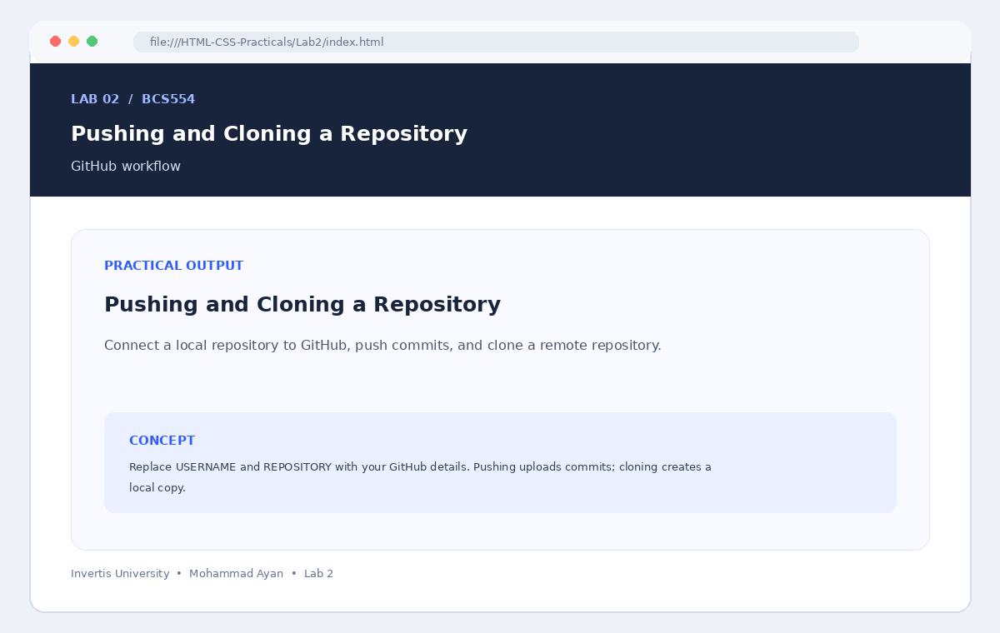

# Lab 2: Pushing and Cloning a Repository

**University:** Invertis University, Bareilly  
**Course:** B.Tech CSE – Third Year  
**Subject:** HTML & CSS Development Lab (BCS554)  
**Student:** Mohammad Ayan  
**Roll Number:** 2410303268

## Objective
Connect a local repository to GitHub, push commits, and clone a remote repository.

## Technology / concept
GitHub workflow

## Files
- `index.html` – practical webpage / task explanation
- `style.css` – styling
- `images/screenshot.png` – preview image of the expected output

## How to run
1. Open `index.html` in a modern web browser.
2. Review the page and inspect the HTML and CSS source.
3. For Lab 1 and Lab 2, also perform the Git commands in a terminal using your own GitHub repository.

## Output

## Notes
Replace USERNAME and REPOSITORY with your GitHub details. Pushing uploads commits; cloning creates a local copy.

**Before submission:** Replace `YOUR_ROLL_NUMBER` with your actual roll number. The included PNG is a representative preview; capture a fresh screenshot from your browser after running your own code if your instructor requires an actual execution screenshot.
